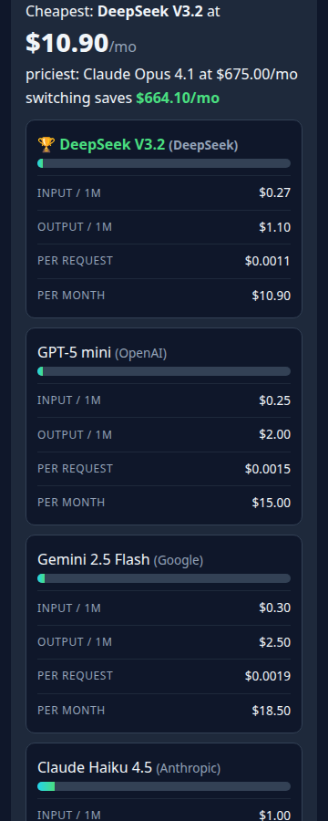
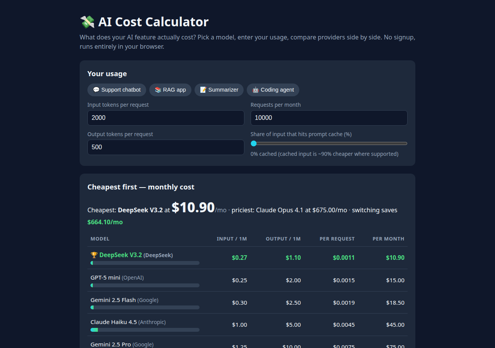

# ai-cost-calculator

**What does your AI feature actually cost?**

A free browser tool that estimates LLM API costs before you ship. Pick a model, enter your usage, and compare providers side by side — in dollars, not tokens.

**[▶ Try it in 10 seconds — live demo](https://smabdulmueid97.github.io/ai-cost-calculator/)**

No signup. No backend. Your numbers never leave the page.

---

## Screenshots

| Mobile | Desktop |
|---|---|
|  |  |

> Tested at 360 / 768 / 1280 px — no horizontal overflow, no clipped buttons.

---

## What it does

- **9 models compared** — GPT-5, GPT-5 mini, GPT-4o, Claude Sonnet 4.5, Claude Haiku 4.5, Claude Opus 4.1, Gemini 2.5 Pro, Gemini 2.5 Flash, DeepSeek V3.2
- **Your real usage** — input tokens per request, output tokens per request, requests per month
- **Prompt-cache savings** — slide the cache share and see the price drop (cached input is ~90% cheaper where supported)
- **Cheapest first** — monthly cost ranked, with per-request cost and a bar chart
- **Compare up to 3 models** — tap any row to pin it in the comparison
- **Presets** — support chatbot, RAG app, summarizer, coding agent, one click

## Why this exists

Most teams pick a model for quality and find out the cost later. A support chatbot doing 10k requests a month can cost $30 on one model and $900 on another — for the same answers. The cheapest model that does the job is usually the right one.

## Run it locally

Just open `index.html` in a browser. That's it — plain HTML/CSS/JS, no build step, no dependencies.

## Prices

Prices are approximate public list prices as of November 2026. Providers change them — always verify with the provider before budgeting. Caching and batch discounts can cut costs further.

## Related repos

- [ai-crypto-trader](https://github.com/smabdulmueid97/ai-crypto-trader) — paper-trading simulator with live prices and a rule-based signal engine

## License

MIT — free to use, modify, and ship.
